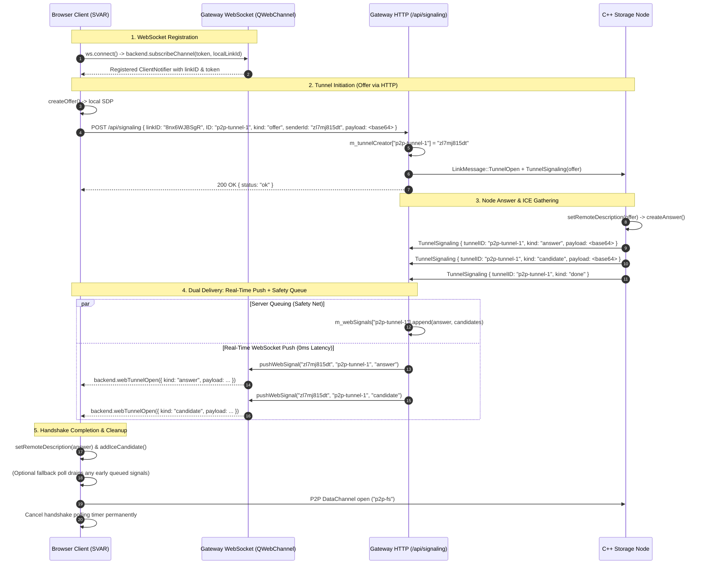

# OMD 3.0 P2P Protocol Specification & Architecture

## 1. Overview & Core Principles

OMD 3.0 implements a hybrid **P2P WebRTC DataChannel** architecture connecting web clients (SVAR Svelte 5 frontend), desktop/embedded storage nodes (C++ nodes with `libdatachannel`), and the cloud gateway (`omd-server`).

### Design Pillars
1. **Direct P2P Data Plane**: All file operations, streaming media, range requests, terminal sessions, and chat messages traverse direct WebRTC DataChannels (SCTP over DTLS over UDP), bypassing the cloud gateway for bandwidth-heavy traffic.
2. **Hybrid Dual-Delivery Signaling Plane**:
   - **Outbound Signaling**: Client-initiated tunnel opening and offer SDP/candidates are transmitted via HTTP `POST /api/signaling` with explicit `senderId` tracking, guaranteeing atomic submission without socket handshake race conditions.
   - **Inbound Real-Time WebSocket Push**: The gateway pushes answer SDP and remote ICE candidates to web clients in real-time via QWebChannel (`backend.webTunnelOpen`), achieving zero latency.
   - **Early-Signal Safety Queue**: The gateway simultaneously queues incoming signals in `m_webSignals[tunnelID]`. A lightweight handshake poll (300ms) catches any early answer generated by fast nodes (<50ms) before the client WebSocket finishes registration, terminating permanently as soon as the DataChannel opens.
3. **Deterministic Device-Targeted Routing**: WebSocket clients register their unique local device `linkID` with `backend.subscribeChannel(token, linkID)`. Push signals are routed to the specific device's `ClientNotifier`, enabling multiple clients (e.g. Chrome, Brave, mobile app) logged into the same user/DID account to run concurrently without signal collisions or device drops.
4. **Event-Driven Presence Plane**: WebSocket / QWebChannel push notifications (`linkConnected`, `linkDisconnected`) inform the UI of node presence in real-time.
5. **Decentralized Identity (DID)**: Nodes and web clients authenticate and discover peers using cryptographic keypairs (GunDB SEA / NIST P-256) mapped to certificate-based LinkIDs.

---

## 2. Architecture & Topology

```
                  ┌─────────────────────────────────────────────────────────┐
                  │                    OMD Cloud Gateway                    │
                  │             (omd-server / OnMyDiskLinkServer)           │
                  │                                                         │
                  │  • HTTP Signaling:  /api/signaling (with senderId)      │
                  │  • Device Status:   /api/devices                        │
                  │  • WebSocket Push:  QWebChannel backend.webTunnelOpen   │
                  │  • Early Queue:     m_webSignals[tunnelID]              │
                  │  • STUN / TURN:     port 3478 (coturn)                  │
                  └────────▲────────────────────────────────▲───────────────┘
                           │ Inbound WS Push:               │ Control Link:
                           │ backend.webTunnelOpen          │ LinkMessage::TunnelSignaling
                           │ Outbound HTTP:                 │ (TLS control socket)
                           │ POST /api/signaling            │
                 ┌─────────┴──────────────┐        ┌────────┴───────────────┐
                 │      Browser PWA       │        │   C++ Storage Node     │
                 │     (SVAR Client)      │        │  (beelink / embedded)  │
                 └────────▲───────────────┘        └────────▲───────────────┘
                          │                                 │
                          └─────────── P2P Tunnel ──────────┘
                                 WebRTC DataChannel
                             (DTLS/SCTP via Direct ICE)
```

---

## 3. Identifiers & Key Entities

| Identifier | Type | Description | Example |
| :--- | :--- | :--- | :--- |
| **`linkID`** | 10-char string | Unique node identifier derived from client SSL certificate or DID key mapping. | `8nx6WJBSgR`, `zl7mj815dt` |
| **`peerID`** | 32-hex string | Ephemeral link/session identifier for active gateway socket connections. | `c814de38f32ebe6ade...` |
| **`tunnelID`**| String | Unique P2P session ID generated by the initiating client. | `p2p-tunnel-t9spuhv3` |
| **`senderId`**| 10-char string | Local linkID of the client initiating the tunnel, ensuring targeted delivery of the response. | `zl7mj815dt` |
| **`service`** | String | Application protocol multiplexed over the DataChannel (`p2p-fs`, `ssh`, `chat`). | `p2p-fs` |

---

## 4. Connection Establishment & Signaling Protocol

### 4.1 Hybrid Signaling Flow Diagram



### 4.2 Signaling Payloads (`POST /api/signaling`)

All signaling messages use `POST /api/signaling` with `Content-Type: application/json`:

#### Offer Payload (Browser $\rightarrow$ Gateway)
```json
{
  "linkID": "8nx6WJBSgR",
  "ID": "p2p-tunnel-t9spuhv3",
  "kind": "offer",
  "payload": "dj0wDQpvPS1...",
  "port": 0,
  "service": "p2p-fs",
  "senderId": "zl7mj815dt",
  "token": "d29de13ff7430dd1975a18f51f953b6f"
}
```

#### Candidate Payload (Browser $\rightarrow$ Gateway)
```json
{
  "linkID": "8nx6WJBSgR",
  "ID": "p2p-tunnel-t9spuhv3",
  "kind": "candidate",
  "payload": "YT1jYW5kaWRhdGU6...",
  "senderId": "zl7mj815dt"
}
```

#### WebSocket Push Event (`backend.webTunnelOpen`)
Emitted by `ClientNotifier` directly to subscribed QWebChannel client:
```json
{
  "ID": "p2p-tunnel-t9spuhv3",
  "tunnelID": "p2p-tunnel-t9spuhv3",
  "kind": "candidate",
  "payload": "YT1jYW5kaWRhdGU6NCAxIFVEUCAxMDQ3ODA3..."
}
```

#### Safety Fallback Poll Payload (Browser $\rightarrow$ Gateway)
```json
{
  "linkID": "8nx6WJBSgR",
  "ID": "p2p-tunnel-t9spuhv3",
  "kind": "poll",
  "senderId": "zl7mj815dt"
}
```

---

## 5. Device Discovery & Presence System

### 5.1 HTTP Device Status Endpoint
* **Endpoint**: `POST /api/devices`.
* **Scope**: Returns the subset of requested `linkIds` that currently hold active, connected states (`Connected`, `Connecting`, or `Inactive` keep-alive) in `OnMyDiskLinkServer`.
* **DID Compatibility**: Whitelisted in `checkAuth` so that anonymous and DID-based clients can query device status without pre-existing session cookies.

### 5.2 Real-time WebSocket Push Notifications
* **Channel**: QWebChannel over WebSocket (`/webrtc` or port `9988`).
* **Signals**:
  * `linkConnected(QString linkId)`: Broadcast to all connected clients when a storage node connects or reconnects to the gateway.
  * `linkDisconnected(QString linkId)`: Broadcast when a storage node drops connection.
  * `webTunnelOpen(QJsonObject signalData)`: **Targeted push** delivering incoming signaling events exclusively to the client matching `senderId` / `m_tunnelCreator`.

### 5.3 Local Network Discovery (Nearby Nodes)
* **Endpoint**: `GET /api/my-nearby` or `GET /api/devices/nearby`.
* **Mechanism**: The gateway groups nodes by caller public IP address (`X-Forwarded-For` or remote socket address). Clients on the same LAN discover local OnMyDisk nodes automatically.

---

## 6. Multi-Device & Multi-Tab Isolation

In previous versions, multiple browser tabs or devices logged into the same account collided because signaling responses were dispatched by username (`alexey`), routing browser responses to the mobile device.

In OMD 3.0:
1. **Unique Client LinkIDs**: Every browser instance creates and maintains a persistent, unique client `linkID` (`getOrCreateLocalLinkId()`).
2. **Channel Subscription**: When connecting to the gateway WebSocket, the client registers this ID via `backend.subscribeChannel(token, linkId)`.
3. **Tunnel Ownership**: When creating a tunnel, `senderId` is stored in `m_tunnelCreator[tunnelID]`.
4. **Targeted Push**: The gateway routes incoming signals to `ClientNotifier` instances where `n->getLinkId() == targetID`, ensuring exact 1-to-1 delivery even when multiple devices share the same DID identity.

---

## 7. DataChannel Application Protocols & JSON-RPC Wire Format

Once the WebRTC DataChannel is open (label `"p2p-fs"`, `"ssh"`, etc.), communication uses atomic frames.

### 7.1 `p2p-fs` JSON-RPC Protocol Wire Format

All requests and responses use JSON text frames:
* **Request Envelope**:
  ```json
  {
    "id": 42,
    "cmd": "CommandName",
    ...params
  }
  ```
* **Success Response**:
  ```json
  {
    "id": 42,
    "status": "ok",
    "result": { ... }
  }
  ```
* **Error Response**:
  ```json
  {
    "id": 42,
    "status": "error",
    "error": "Error description message"
  }
  ```

#### Authentication & Authorization Commands
1. **`AuthInfo`**:
   - Request: `{"id": 1, "cmd": "AuthInfo", "didPub": "<callerDidPub>"}`
   - Response: `{"result": {"name": "NodeHost", "hasPairedDids": true, "paired": false, "authLevel": "unauthenticated"}}`
2. **`Login`**:
   - Request: `{"id": 2, "cmd": "Login", "user": "username", "pass": "secret", "didPub": "<callerDidPub>"}`
   - Verification: Linux `/sbin/unix_chkpwd` + shadow / Windows `LogonUserW`.
   - Action on success: Saves `didPub` into node's `PairedDIDs` list; elevates session to `P2PAuthLevel::Admin`.
   - Response: `{"status": "ok", "result": {"user": "...", "name": "...", "linkId": "...", "paired": true, "authLevel": "admin"}}`
3. **`PairAuth`**:
   - Request: `{"id": 3, "cmd": "PairAuth", "didPub": "<callerDidPub>"}`
   - Action: Elevates session to `P2PAuthLevel::Admin` if `isDIDPaired(m_settings, didPub)` is true.
   - Response: `{"status": "ok", "result": {"name": "...", "linkId": "...", "paired": true, "authLevel": "admin"}}`
4. **`SetScope`**:
   - Request: `{"id": 4, "cmd": "SetScope", "scope": ["/ShareName/Folder"], "writable": true}`
   - Action: Establishes `P2PAuthLevel::ScopedGuest` for public link visitors.

#### Filesystem & Share Commands
5. **`FileInfo`**:
   - Logical shares: `{"cmd": "FileInfo", "path": "/Photos"}` $\rightarrow$ returns child items with metadata (size, mime, lastModified).
   - Home browsing (Admin only): `{"cmd": "FileInfo", "path": "/Documents", "home": true}` $\rightarrow$ returns entries on host filesystem.
6. **`Open` / `Read` / `Write` / `Close`**:
   - Streaming chunks over DataChannel with base64 payloads and byte offsets.
7. **`HomeMkDir` / `HomeWrite`**:
   - Direct physical folder creation and chunked file upload into host storage.
8. **`Copy` / `Move` / `Rename` / `Remove`**:
   - Logical share file manipulation via `CloudResource` methods.
9. **`HomeCopy` / `HomeMove` / `HomeRename` / `HomeRemove`**:
   - Physical host filesystem file manipulation (Admin only).
10. **`AddShare` / `CreateShare` / `RevokeShare`**:
    - Manage logical node shares (Admin only).

#### Node Management & Settings Commands
11. **`GetSettings`**:
    - Request: `{"id": 10, "cmd": "GetSettings"}`
    - Response: `{"status": "ok", "settings": {"automount": true, "updateSamba": true, "aiBase": "http://localhost:8000", ...}}`
12. **`SetSettings`**:
    - Request: `{"id": 11, "cmd": "SetSettings", "settings": { ... }}`
    - Action: Updates `OnMyDiskSettings` in memory and writes to persistent `QSettings`.
13. **`CheckUpdate` / `ApplyUpdate`**:
    - Checks for C++ agent OTA update and triggers update helper script.
14. **`Exec` / `ResolvePath`**:
    - Path expansion and command execution (Admin only).

### 7.2 `ssh` / `terminal` (Browser Terminal)
* Multiplexes bidirectional terminal I/O between the web browser's **xterm.js + libssh2 WebAssembly** engine and the node's local SSH daemon or embedded PTY runner.
* Enables terminal access to remote nodes without open inbound firewall ports.

### 7.3 `chat` (Peer-to-Peer Messaging)
* Bidirectional JSON message exchange for decentralized chats, notifications, and group collaborations.

---

## 8. Fault Tolerance, Reconnection & Cleanup

1. **ICE Gathering & Timeouts**: If WebRTC candidate gathering or connection state remains in `connecting` / `failed` after 15 seconds, the handshake times out, releases resources, and reports `disconnected`.
2. **Signal Deduplication**: Both answer SDP (`pc.remoteDescription` guard) and ICE candidates (checked against a `Set` of applied candidate strings) are deduplicated, guaranteeing safe coexistence between WebSocket push and fallback polling.
3. **Polling Teardown**: The handshake polling timer is unconditionally cancelled immediately when `dc.onopen` fires, eliminating background HTTP requests once the DataChannel is established.
4. **Session Teardown**: When closing a tunnel, `kind: "tunnel-closed"` is sent to release node resources, and the gateway purges the `tunnelID` from `m_tunnels` and `m_webSignals`.
