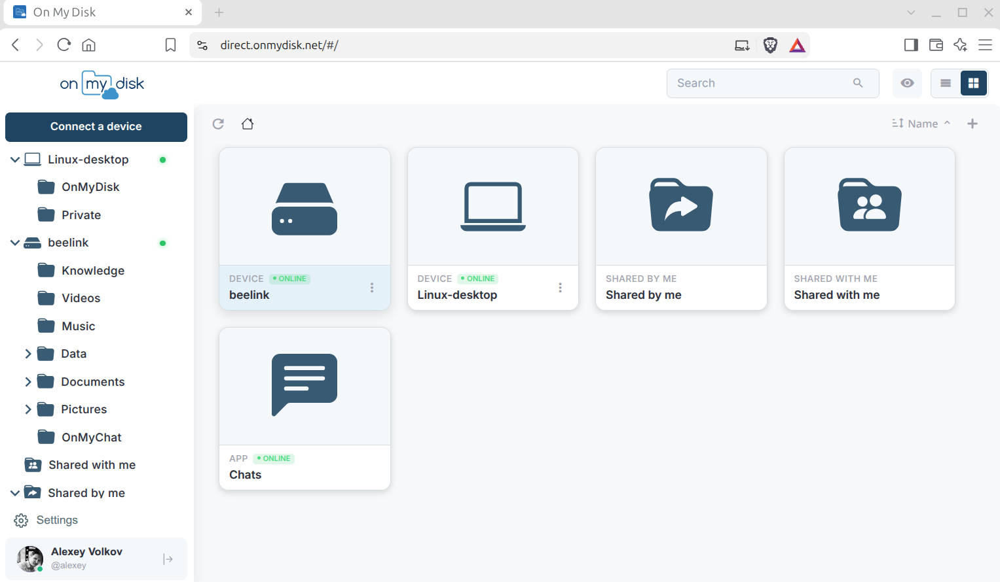
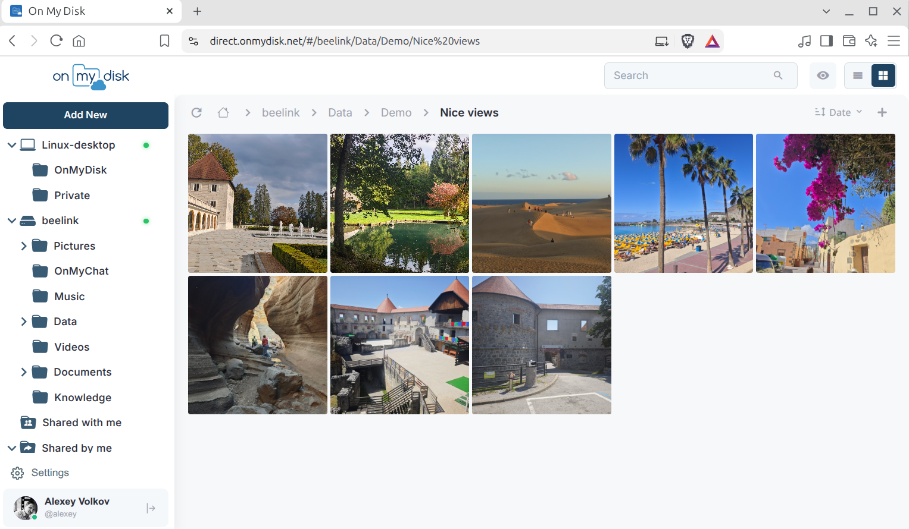
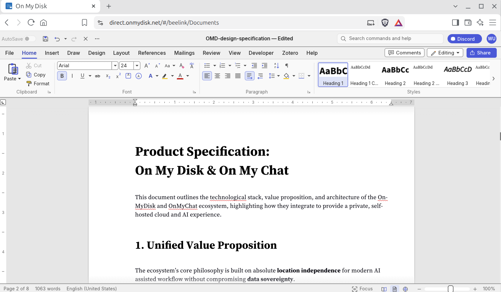
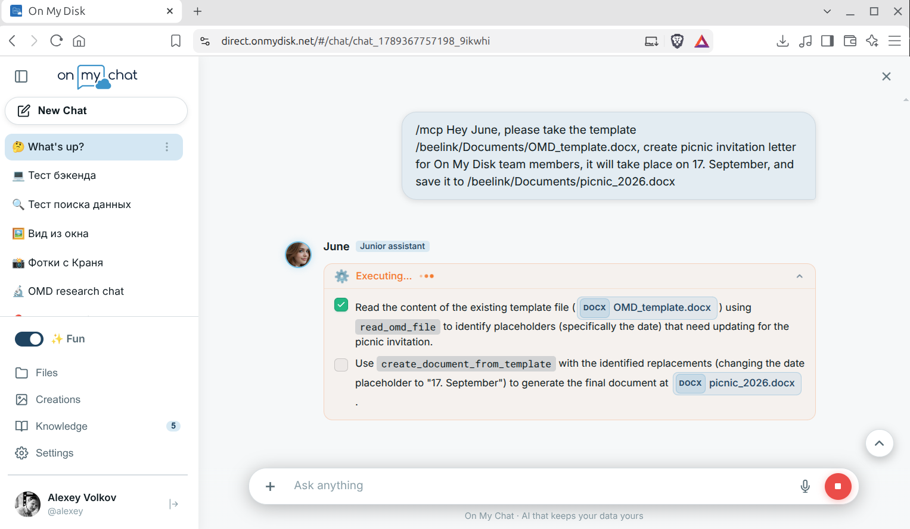
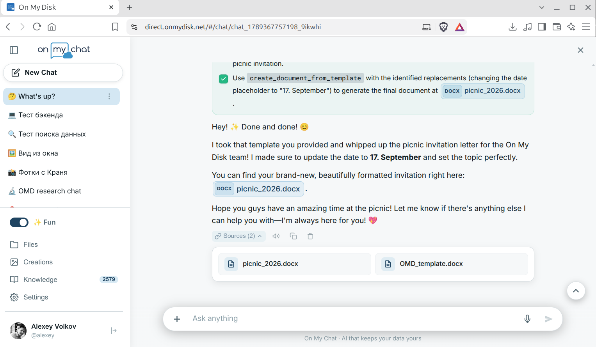
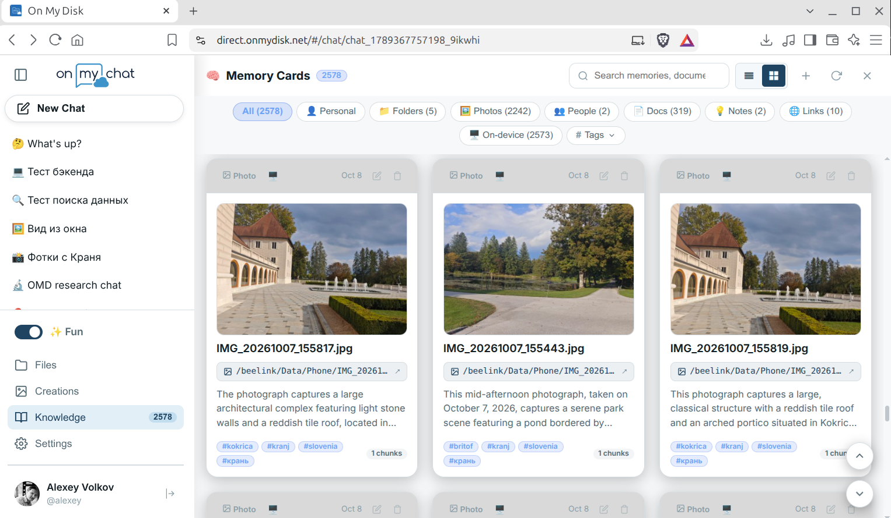
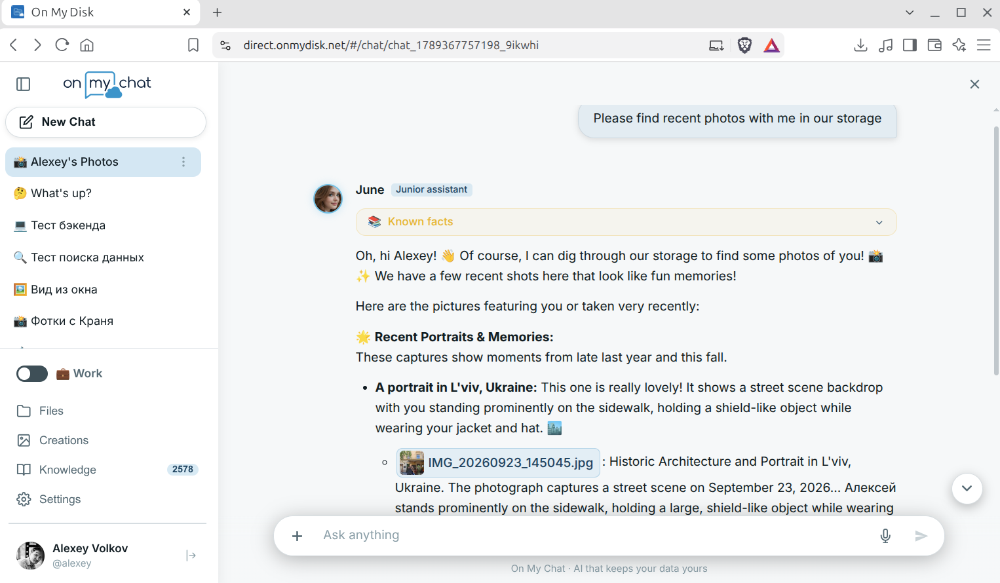
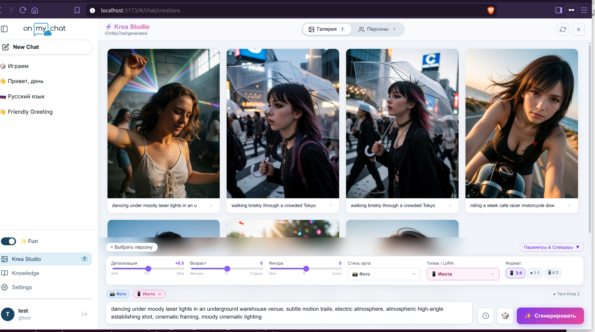
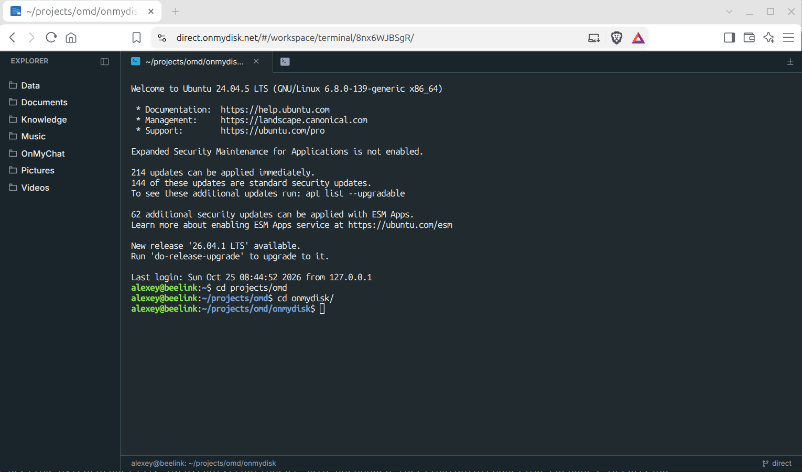
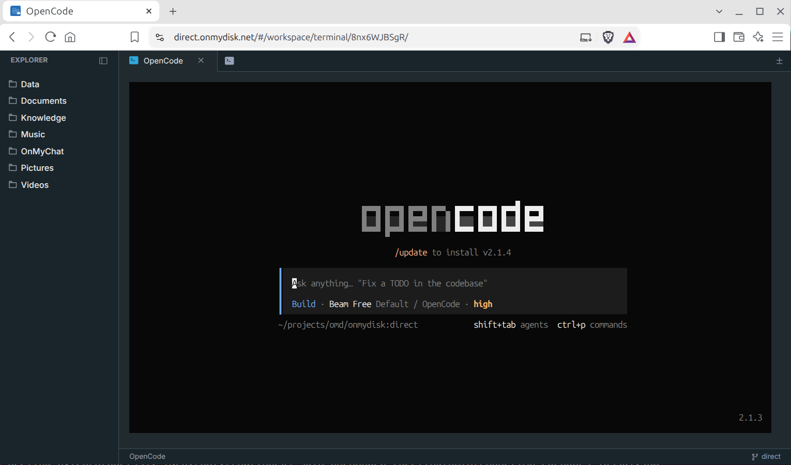

# On My Disk **Direct**

> Self-hosted personal cloud with a direct P2P data plane.
> Your files stay on your devices — the gateway just coordinates peers.

[](LICENSE)
[](https://www.qt.io/)
[](svar/)
[](https://direct.onmydisk.net)
[](https://onmychat.com/?launch=1)
[](https://discord.gg/qAQpfmrBPW)
[](https://whop.com/onmychat/on-my-chat-sponsorship-program)



> **⚡ Try it right now — zero installation required:**
> - 📂 **File Manager:** [direct.onmydisk.net](https://direct.onmydisk.net) — access and share your files and folders right from your browser, edit office docs, and stream media.
> - 💬 **AI Assistant:** [onmychat.com](https://onmychat.com/?launch=1) — ask anything about On My Disk Direct or On My Chat.

## Overview

OnMyDisk 3.0 **Direct** is a distributed file-access platform. Instead of uploading your data
to a cloud vendor, you run a lightweight **gateway** and keep **storage nodes** on
your own hardware — PCs, NAS boxes, single-board computers, and WiFi routers.
Browsers and mobile apps connect to nodes **directly over WebRTC DataChannels**;
the gateway never sees file contents — only signaling, presence, and (when direct
P2P is unavailable) relayed traffic that stays end-to-end encrypted.

There are no server-side user accounts: identities are GunDB SEA keypairs
(`did:gun:<pub>`). The `gun-hub` service runs the GunDB relay that keeps chats,
profiles, settings and device lists in sync across the user's devices, and
handles DID authentication — credential verification and device certificate
issuance. The same web client bundles a file manager, online documents
and spreadsheets, a terminal, chat, and a local AI assistant working over your
own data.

## Value Proposition

We are open-source believers, and we have always been inspired by legends like
Nextcloud as a self-hosted cloud and Open WebUI as a local AI framework. But
our vision goes a step further: a **secure, decentralized platform** for remote file access, sharing, collaboration, and communication with your local AI harness — with **no dedicated servers to rent or maintain**. Any ordinary computer plugged into the wall and online is ready to serve, with no port forwarding, no DDNS, and no Let's Encrypt certificates required.

On My Disk Direct pairs a near-zero barrier to entry with complete scalability.
You can start with nothing more than a web browser, drop a lightweight agent
onto any computer to create a storage node (and an AI node if you have a GPU),
or deploy a fully self-contained network with your own private signaling
gateway and end-to-end encryption.

In every scenario, your data stays with you, and it is accessed directly —
without third-party tunnels or relays. The same universal interface on your
mobile device finds the shortest route to your personal storage and AI
assistant running on your home machine. And if your home hardware can't handle
the heavy models, a public AI node on the network is always available — or one
of your friends can share access to their GPU.

## Highlights

- **Direct P2P data plane** — file operations, media streaming, terminal sessions,
  and chat travel over WebRTC DataChannels (DTLS/SCTP); the gateway is a fallback
  relay, not a bottleneck.
- **Decentralized identity** — DID keypairs (GunDB SEA, NIST P-256); node
  LinkIDs derived from CA-signed device certificates and paired with the
  user's DID via node-issued pairing secrets; per-device auth levels up to
  Admin.
- **Storage stays at home** — run nodes on Linux boxes, Raspberry Pi–class boards
  (buildroot), and openwrt/InnBox WiFi routers.
- **End-to-end encryption** — every peer connection — files, media streams,
  terminal sessions — rides an always-encrypted WebRTC DataChannel: DTLS keys
  are negotiated peer-to-peer and never reach the gateway, so it stays blind
  even when it has to relay traffic. Identity is protected equally well:
  GunDB SEA DID keypairs (NIST P-256), CA-signed device certificates, and a
  TLS-secured control link between nodes and the gateway.
- **One client everywhere** — the SVAR Svelte File Manager PWA is served by the gateway and
  embedded into native shells (Capacitor iOS/Android in `mobile/`).
- **Zero-config App Proxy** *(coming soon)* — embed local web apps like Memos
  directly into the UI over a P2P tunnel, with no reverse proxy or port
  forwarding to set up.
- **Integrated terminal** — manage your home computer remotely from the same
  web/mobile client: the embedded terminal runs over the P2P link, so you can
  drive your favorite AI coding harness — OpenCode, Hermes, Codex, Claude and
  other TUI agents — right on the node.
- **Integrated document apps** — open, view and edit documents, spreadsheets
  and presentations right in the client (WordCraft, GridCraft, DeckCraft),
  along with built-in PDF, Markdown, audio and video viewers.
- **Automatic sync & indexing** — camera roll and mission-critical files from
  your mobile and desktop devices are synced automatically to your primary
  node and indexed in the background, so the RAG below always sees fresh
  content.
- **Local AI with vision and RAG** — chat with your documents, generate smart
  photo galleries with on-device facial recognition (Gemma4/InsightFace),
  completely offline. See [On My Chat](https://github.com/alexeyvolkoff/onmychat).

## Tour

Take a visual walkthrough of On My Disk Direct in action — from decentralized P2P storage and embedded office editors to in-browser developer terminals, autonomous local AI agents, and creative studios:

### 1. P2P File Manager & Photo Viewer
Access storage nodes across your devices over direct WebRTC DataChannels. Browse folders, stream media, and view responsive photo galleries with zero middleman and no third-party cloud.



### 2. Integrated Document Editing (WordCraft, GridCraft, DeckCraft)
Open, view, and edit documents, spreadsheets, and presentations right inside the browser while keeping complete formatting fidelity, styles, and layouts intact.



### 3. Autonomous AI Agent with Tool Execution (MCP)
Interact with your personal AI assistant ([On My Chat](https://github.com/alexeyvolkoff/onmychat)) powered by local LLMs. The assistant autonomously drafts execution plans and calls verified tools across your storage — inspecting templates, extracting values, and producing formatted office documents.

| Step 1: Autonomous Planning & Inspection | Step 2: Completed Document Generation |
| :---: | :---: |
|  |  |

### 4. Semantic Memory Cards & RAG Indexing
Documents from your laptop and photos from your camera roll could be synced to your primary storage node and indexed in the background. The Knowledge base organizes your storage into multimodal memory cards with automated captions, semantic tags, and entity recognition.



### 5. On-Device Facial Recognition & Multimodal Retrieval
Search your memories using natural language. Local vision models and facial recognition find specific people, places, and events directly on your private storage without sending raw images outside your local network.



### 6. Creative Studio: Local Generative AI
A built-in creative workspace featuring a curated roster of local diffusion models. It scales to your hardware — from lightweight SDXL workflows optimized for fast, small-footprint generation, to bleeding-edge community checkpoints like CyberRealistic Krea 2 and Anima for high-performance GPU setups. Fine-tune your prompts, adjust inference settings, and render high-resolution artworks directly into your private storage.



### 7. In-Browser Terminal & Remote AI Coding Harnesses
Manage your remote machines and developer workspaces straight from any browser without setting up port forwarding, public IPs, or third-party VPN tunnels. The integrated terminal connects directly over the secure P2P WebRTC data plane via SSH, providing responsive command-line access to your nodes. Run builds, administer systems, or drive your favorite autonomous AI coding agents and TUI harnesses — like OpenCode, Claude Code, Aider, and Hermes — right where your repositories and local compute live.

| Remote SSH Terminal Session | Autonomous AI Coding Harnesses |
| :---: | :---: |
|  |  |

## Architecture

```
  Browser / Mobile (SVAR PWA)               Storage Node (C++ / Qt)              AI Node (OnMyChat)
  ┌──────────────────────────┐              ┌──────────────────────────┐  RAG /  ┌──────────────────────────┐
  │ file manager · documents │ WebRTC Data  │ files · media · terminal │  tools  │ FastAPI · ChromaDB       │
  │ chat · terminal · AI     ├──Channel────►│ onmydisk node            ├────────►│ MCP agent · visual RAG   │
  └────▲──────────▲──────────┘   (direct)   └──────────▲───────────────┘         └────────────┬─────────────┘
       │          │                                    │                                      │ local API
       │ auth,    │ WebSocket push: answers & ICE      │ TLS control link                     │ (inference)
       │ sync     │ HTTP POST /api/signaling           │ (LinkMessage)                        ▼
       │ certs    └─────────────┬──────────────────────┘                         ┌──────────────────────────┐
       ▼                        │                                                │ Local LLM (Ollama / GPU) │
  ┌─────────────────────┐  ┌────┴───────────────────────┐                        │ Gemma 4 · Vision         │
  │ gun-hub             │  │ OMD Gateway (omd-server)   │                        │ Stable Diffusion (SDXL)  │
  │ GunDB relay: chats, │  │ signaling · presence ·     │                        └──────────────────────────┘
  │ profiles, settings, │  │ relay fallback (coturn)    │
  │ devices · DID certs │  │                            │
  └─────────────────────┘  └────────────────────────────┘
```

## Repository Layout

| Path | What it is |
| :--- | :--- |
| [`Gateway.pro`](Gateway.pro) | qmake project of the gateway (`omd-server`) |
| [`Node.pro`](Node.pro) | qmake project of the storage node (`onmydisk`); embedded flavour by default, router flavour via `DEFINES+=ROUTER` |
| [`Node/`](Node/) | Node C++ sources, shared `client.pri` build logic, deploy scripts |
| [`OnMyDiskLink/`](OnMyDiskLink/) | Core link/P2P library shared by gateway and nodes |
| [`svar/`](svar/) | SVAR web client (Svelte 5 + Vite, PWA) |
| [`mobile/`](mobile/) | Capacitor shells for iOS and Android |
| [`gun-hub/`](gun-hub/) | GunDB relay — syncs chats, profiles, settings and device lists between the user's devices; verifies credentials, issues device certificates |
| [`webpush/`](webpush/) | Web push notification service |
| [`docs/`](docs/) | Architecture, product spec, user guides |
| [`tests/`](tests/) | API tests ([hurl](https://hurl.dev/)) |
| [`etc/`](etc/) | Sample configurations |

## Quick Start

For most laptops, desktops, and mini-PCs, run **one command** to install the **On My Disk 3.0 Node** together with **[On My Chat](https://github.com/alexeyvolkoff/onmychat)** in **Agentic AI mode**. Your files and private RAG knowledge index stay **100% on your device**, while heavy LLM & image generation runs automatically over encrypted P2P on a remote GPU:

**🐧 Linux (`Ubuntu / Debian / Armbian`)**

```bash
curl -fsSL https://forge.onmydisk.net/repo/Linux/install-onmydisk.sh | bash -s -- --agentic
```

**🪟 Windows 10 / 11 (`PowerShell` — per-user, no Administrator rights needed)**

```powershell
& ([scriptblock]::Create((irm https://forge.onmydisk.net/repo/Windows/install-onmydisk.ps1))) -Agentic
```

**🍎 macOS (`Terminal`, Apple Silicon — per-user, no `sudo` needed)**

```bash
curl -fsSL https://forge.onmydisk.net/repo/macOS/install-onmydisk.sh | bash -s -- --agentic
```

> [!TIP]
> **Have a GPU? Run Full Local AI:** Replace `--agentic` with **`--gpu`** (Linux / macOS Apple Silicon) or `-Agentic` with **`-Gpu`** (Windows NVIDIA GPU) to install **Ollama** locally and run all LLM inference directly on your own hardware (`AI_PROVIDER = local`).

> [!NOTE]
> **Storage-Only Node (No AI):** Need only P2P file sharing and remote SSH access without **On My Chat**? Run the basic installer instead:
> - **Linux:** `curl -fsSL https://forge.onmydisk.net/repo/Linux/install-onmydisk.sh | bash`
> - **Windows (`PowerShell`):** `irm https://forge.onmydisk.net/repo/Windows/install-onmydisk.ps1 | iex`
> - **macOS:** `curl -fsSL https://forge.onmydisk.net/repo/macOS/install-onmydisk.sh | bash`

**After installation:** Sign in at [**direct.onmydisk.net**](https://direct.onmydisk.net) and connect your device from **Settings → Devices** (or open the local claim page at `http://localhost:8081` on Windows/macOS, `http://localhost/` on Linux). For OpenWrt routers, manual `.deb` packages, and detailed operating modes, see the [Node Deployment Guide](https://onmydisk.org/advanced/).

## Advanced Setup: Deploy Your Own Isolated Gateway

If you want a **completely self-contained, isolated private network** — for an organization, lab, or sovereign home setup with zero dependency on the public `direct.onmydisk.net` coordinator — you can host the entire signaling and identity stack yourself.

Our CI builds the web client, compiles the gateway, and publishes the Docker image as
`onmydisk/onmydisk:direct` — the web client is baked into the image, so no local
build is needed. The GunDB relay (`gun-hub`) and TURN server (`coturn`) are part of the same Compose stack, so one command brings up a fully independent deployment:

```bash
git clone https://github.com/alexeyvolkoff/onmydisk.git
cd onmydisk
docker compose up -d
```

- **Gateway & Web Client:** `http://localhost:8080` (data, PKI, and logs live under `srvconf/`, `bin/`, `www/`, `logs/`).
- **GunDB DID Relay (`gun-hub`):** `http://localhost:8765` (data lives under `gun-hub/data/`).
- **coturn TURN Server:** port `3478` (config in `coturn/turnserver.conf`).

Point your storage nodes to your custom gateway host in `onmydisk.conf`, and your entire P2P cloud operates inside your own infrastructure. To update only the relay, use the `deploy_gun_hub` CI job (or rebuild the `omd-gun-hub` service locally).

### Optional: peer replication between hubs

Set `GUN_PEERS` (comma-separated list of other hub URLs, e.g.
`wss://hub2.example.com:8765/gun`) in the `omd-gun-hub` environment to enable
GunDB replication between instances. Leave it empty for a standalone hub.
For clustered setups also set the same `DELETE_TOKEN_SECRET` on every instance.

## Building from Source

Prerequisites: Qt 5.15 (qtbase, webchannel, websockets, xmlpatterns, svg),
a C++17 compiler, and optionally [libdatachannel](https://github.com/paullouisageneau/libdatachannel)
for P2P (without it the node runs relay-only) and taglib.

```bash
# Gateway -> run/bin/omd-server
qmake Gateway.pro
make -j$(nproc)

# Storage node, embedded flavour -> Node/target/usr/bin/onmydisk
qmake Node.pro
make -j$(nproc)

# Storage node, router/InnBox flavour -> Node/router/opt/bin/onmydisk
qmake DEFINES+=ROUTER Node.pro
make -j$(nproc)
```

### Work on the web client

```bash
cd svar
npm install
npm run dev      # hot-reload dev server
npm run build    # production bundle in svar/dist (CI does this automatically)
```

## Development

- **VS Code tasks** (`Terminal → Run Task…`): `QMake/Build Gateway|Node` in
  Debug and Release, plus `Generate compile_commands.json` for IntelliSense.
- **Tests**: `tests/*.hurl` cover the public HTTP API — run with
  `hurl --variable password=... tests/getattributes.hurl`.
- **CI**: GitLab pipeline (`.gitlab-ci.yml`). `build_direct` builds the frontend,
  compiles the gateway in the `omd-builder` container and pushes
  `onmydisk/onmydisk:direct` to Docker Hub; `deploy_direct` rolls it out to the
  integration host with `docker compose`. Router jobs build openwrt/InnBox
  images, connector jobs produce `.deb` packages for amd64/arm64.

## Documentation

- [Developer's Guide](docs/DEVELOPERS_GUIDE.md) — setup, build, and configuration
- [Product Specification](docs/PRODUCT_SPECIFICATION.md) — value proposition and stack
- [User Guide](docs/USER_GUIDE.md) — end-user instructions (also [EN](docs/USER_GUIDE_EN.md), [SI](docs/USER_GUIDE_SI.md))
- [RAG](docs/RAG_3_0.md) · [Search & RAG](docs/SEARCH_AND_RAG.md) — private AI over your data

## Feedback

Questions, ideas, bug reports — we're happy to hear from you:

- Discord: https://discord.gg/qAQpfmrBPW
- Telegram: https://t.me/+QbXU7T_6vPEyNzdk
- Email: support@onmydisk.net

## Credits

Thanks for contribution, feedback, influence, and inspiration:

**Ivan Kozinov** · **Borut Rismal** · **Nikola Jovalekić** · **Srđan Petrović** · **Anna Volkova** · **Aurelie Herbelot** · **Olivier Bouzereau** · **CyperDelia** · **Judith Bradford** · **Dominique Severine** · [**NGI Foundation**](https://ngi.eu/)

<table>
  <tr>
    <td width="230" align="center" valign="middle">
      &nbsp;&nbsp;<a href="https://ngi.eu/"></a>
    </td>
    <td valign="middle">
      <sub>Funded in 2023–2024 by the European Union within the framework of the <strong><a href="https://ngi.eu/">NGI Search</a></strong> project under grant agreement <strong>No101069364</strong>. Views and opinions expressed are however those of the author(s) only and do not necessarily reflect those of the European Union or European Commission. Neither the European Union nor the granting authority can be held responsible for them.</sub>
    </td>
  </tr>
</table>

## License

Apache License 2.0 — see [LICENSE](LICENSE).
Copyright © 2015–2026 Bineon d.o.o.
Copyright © 2026 Alexey Volkov
